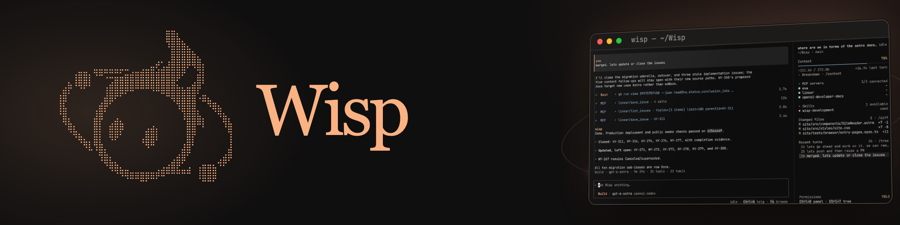

# Wisp

My personal terminal coding agent in Python and Rust, built as a testbed for agent runtime
design—exploring agent engineering from the loop up.

I use Wisp for day-to-day work in the terminal and to study the parts of coding agents that are
easy to hand-wave until you build them end to end: keeping the model/tool loop independent of
persistence and UI, steering or cancelling a run mid-flight without corrupting history, enforcing
tool approvals outside the model's control, compacting context, and driving a native Rust TUI over
a typed RPC boundary.

The codebase and its companion write-ups—including the
[architecture notes](https://whanyu1212.github.io/Wisp/architecture/) and
[Crafting Coding Agents](https://whanyu1212.github.io/Wisp/crafting-agents/), a runnable walkthrough
of the design trade-offs—are public in case they are useful to read, borrow from, or fork.

## How it's built

Every interface is a thin adapter over one event-driven runtime:

```text
CLI / JSONL-RPC / SDK adapters -> RPC command host -> CodingSession -> AgentHarness -> run_agent_loop
```

- **`run_agent_loop`** runs the provider request and tool-execution cycle within a single turn and
  knows nothing about disk persistence or frontends.
- **`AgentHarness`** owns the in-memory transcript across runs, queued user messages, and boundary
  decisions between model requests.
- **`CodingSession`** adds append-only JSONL persistence, context compaction, project trust, and
  tool approval policy.
- **Typed `WispEvent` stream & JSONL-RPC.** The Rust TUI (`rust/wisp-tui`), print/JSON CLI modes,
  and Python SDK (`wisp.sdk`) all consume the same typed event stream rather than maintaining
  separate agent loops.
- **Deterministic offline testing.** A built-in `fake` provider exercises the full runtime,
  protocol, and test suite without API keys or network access.

## Runtime mechanics

- **Mid-run steering.** Corrections sent during an active run apply at the next safe boundary
  between model requests while preserving completed tool work (`Alt+Enter` steers in the TUI;
  `Enter` queues a follow-up).
- **Approval and trust gates.** Read-only tools run directly; file writes, edits, and shell
  commands stop for explicit approval outside the model's control. Project-local settings,
  `AGENTS.md`, and skills stay inert until a repository is trusted.
- **Unwindable cancellation.** Cancelling unwinds in-flight tool processes cleanly and leaves the
  session log valid so `--continue` resumes from the last committed state.
- **Append-only session trees.** Runs are recorded as typed `WispEvent` entries in JSONL files that
  can be resumed, branched, or inspected after the fact.

See [Staying in sync](https://whanyu1212.github.io/Wisp/guide/staying-in-sync.html) and
[Tools & safety](https://whanyu1212.github.io/Wisp/guide/tools-and-safety.html) for how those
invariants are enforced.

## Interfaces

| Surface | Command / entry point | Role |
|---------|-----------------------|------|
| TUI | `wisp` | Fullscreen Rust terminal UI over JSONL-RPC |
| Print | `wisp -p "…"` | Assistant text on stdout, events on stderr (`--yes` required for writes/shell) |
| JSON | `wisp -p "…" --mode json` | One `WispEvent` JSON object per line |
| RPC | `wisp --mode rpc` | Long-lived typed JSONL command/event process |
| Python SDK | `wisp.sdk` (`InProcessWisp`) | In-process or subprocess embedding; see [`examples/sdk/`](examples/sdk/) |

## Running it

Wisp targets Python 3.11+ on macOS and Linux (Windows is best-effort). It supports OpenAI
(including ChatGPT Plus/Pro device sign-in via `/connect`), Anthropic, Google, xAI, and DeepSeek,
plus the offline `fake` provider.

Install the published package with `uv` (native macOS arm64 and Linux x86_64 glibc 2.28+ wheels
bundle the Rust TUI):

```bash
uv tool install --python 3.12 wisp-ai
wisp -p "hello" --provider fake
```

Or run directly from a source checkout (requires Python 3.11+, `uv`, and the Rust toolchain pinned
in `rust-toolchain.toml` for the TUI):

```bash
uv sync --locked
uv run wisp -p "hello" --provider fake

cargo build -p wisp-tui
WISP_RUST_TUI_BINARY="$(pwd)/target/debug/wisp-tui" uv run wisp tui
```

Full usage details live in the [documentation](https://whanyu1212.github.io/Wisp/):
[Installation](https://whanyu1212.github.io/Wisp/guide/installation.html) ·
[Quickstart](https://whanyu1212.github.io/Wisp/guide/quickstart.html) ·
[TUI guide](https://whanyu1212.github.io/Wisp/guide/tui.html) ·
[Python SDK](https://whanyu1212.github.io/Wisp/guide/sdk.html) ·
[Reference](https://whanyu1212.github.io/Wisp/reference/) ·
[Changelog](CHANGELOG.md)

## Project status & issues

Wisp is personal software maintained for my own use and learning rather than as a community-driven
product. Interfaces and internals may change as experiments evolve.

- **Bug reports:** GitHub issues are open for reproducible bug reports.
- **Feature requests & PRs:** I'm not looking for feature requests or external pull requests. Feel
  free to fork the repository if you want to take it in a different direction.
- **Development notes:** Local setup and verification gates are documented in
  [CONTRIBUTING.md](CONTRIBUTING.md).
- **Security:** Please report security vulnerabilities privately as described in
  [SECURITY.md](SECURITY.md).

## License

[MIT](LICENSE)
