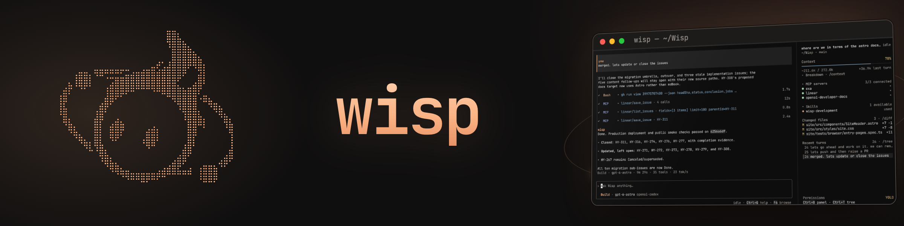

# Wisp

My personal terminal coding agent in Python and Rust — one typed runtime behind a Rust TUI, CLI, JSONL-RPC, and Python SDK. Built for daily work and as a playground for agent runtime engineering.

## Try it

Requires Python 3.11+ on macOS or Linux (Windows is best-effort). Prebuilt macOS arm64 and Linux x86_64 wheels include the Rust TUI:

```bash
uv tool install --python 3.12 wisp-ai

# Credential-free offline smoke test
wisp -p "hello" --provider fake

# Launch the interactive Rust TUI in a repository
cd path/to/project
wisp
```

From a source checkout (needs `uv` and the Rust toolchain in `rust-toolchain.toml` for the TUI):

```bash
uv sync --locked
uv run wisp -p "hello" --provider fake

cargo build -p wisp-tui
WISP_RUST_TUI_BINARY="$(pwd)/target/debug/wisp-tui" uv run wisp tui
```

Supports OpenAI (including ChatGPT Plus/Pro via `/connect`), Anthropic, Google, xAI, DeepSeek, and the offline `fake` provider.

The TUI’s built-in browser is **experimental**. Most testing so far has been in Ghostty and Rex.

## Benchmark result

Wisp passed **all 32 attempts on an eight-task SWE-bench Pro V2 pilot**, including two Hard-51
issues. GPT-6.2 Sol (high effort) and GPT-6.2 Astra (medium effort) each resolved all eight tasks
with both prompt versions. [Method and per-task results](evals/tool_use/reports/2026-11-23-swe-bench-pro-v2.md)

## Explore Wisp

- **[Try Wisp](https://whanyu1212.github.io/Wisp/guide/tui.html)** — Rust TUI workspace (`Session | Files | Browser`, turn-scoped `/diff`, `!` local shell, `/permissions`), quickstart, SDK, and reference
- **[Build an agent — Crafting Coding Agents (Part I)](https://whanyu1212.github.io/Wisp/crafting-agents/)** — five runnable Python chapters from a minimal loop to controlled side effects, plus production case studies
- **[Inspect the evidence — Inside Wisp](https://whanyu1212.github.io/Wisp/architecture/)** — shared runtime boundaries, [SWE-bench Pro V2 pilot & fault-injection/fuzzing receipts](https://whanyu1212.github.io/Wisp/architecture/evals-and-reliability.html), and 50k hydration benchmarks
- **[Docs home](https://whanyu1212.github.io/Wisp/)** · **[Examples](examples/)** · **[Changelog](CHANGELOG.md)**

## Note

Wisp is personal software built for my own use, so things may change without much ceremony. Reproducible bug reports are welcome in issues; I'm not taking feature requests or unsolicited PRs, though it's [MIT-licensed](LICENSE) if you want to read, borrow, or fork it.

Local dev commands are in [CONTRIBUTING.md](CONTRIBUTING.md). Please report security issues privately via [SECURITY.md](SECURITY.md).
