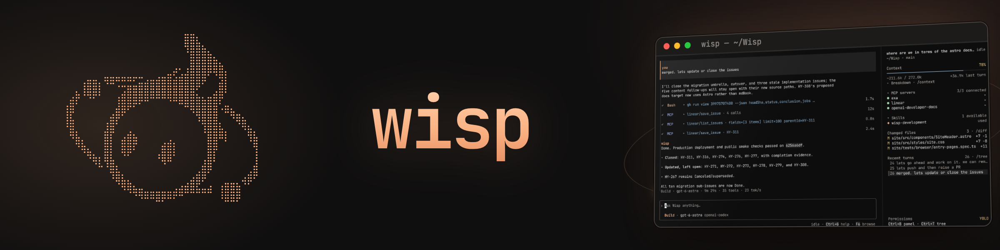

# Wisp



Wisp is a personal terminal coding agent in Python and Rust—built for my own daily work and for the sheer fun of tinkering with agent runtimes from the loop up, shared openly under MIT so you can run it, read it, or build your own.

Its fullscreen Rust TUI, print mode, JSONL RPC process, and Python SDK share one typed runtime. Sessions, approvals, cancellation, and event ordering behave consistently across those interfaces, within the controls each input model can support.

## Choose a starting point

- **[Use Wisp](guide/quickstart.md):** install the application and start working in
  your repository.
- **[Build a coding agent](crafting-agents/index.md):** follow runnable chapters
  from a tiny model-tool loop to controlled side effects, paired with Wisp's own
  engineering trade-offs.
- **[Understand Wisp's architecture](architecture/index.md):** find the runtime
  boundaries and implementation entry points.

## Install Wisp

```bash
uv tool install --python 3.12 wisp-ai
cd path/to/project
wisp
```

## Start reading

Begin with the [Introduction](guide/index.md) and [Quickstart](guide/quickstart.md). Then read [how Wisp stays in sync](guide/staying-in-sync.md), [embed Wisp with the Python SDK](guide/sdk.md), or browse the [Changelog](https://github.com/whanyu1212/Wisp/blob/main/CHANGELOG.md).

The later parts of this book cover the public reference, Wisp's internal architecture, and contributor workflows.
