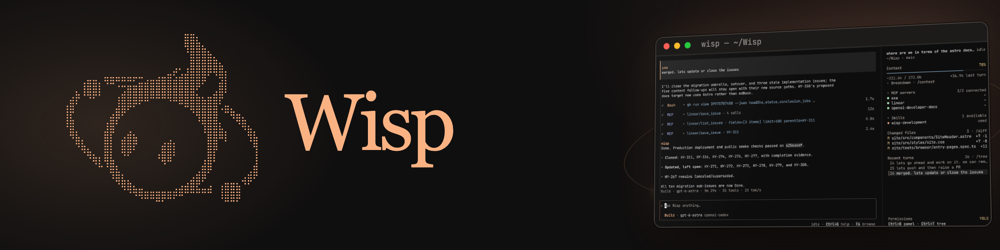

# Wisp



Wisp is a personal terminal coding agent in Python and Rust, built as a testbed for agent runtime design—exploring agent engineering from the loop up.

Its TUI, print mode, JSONL RPC process, and Python SDK share one typed runtime. Sessions, approvals, cancellation, and event ordering behave consistently across those interfaces, within the controls each input model can support.

## Choose a starting point

- **[Build a coding agent](crafting-agents/index.md):** learn the model/tool loop,
  build runnable checkpoints, and examine Wisp's engineering choices and trade-offs.
- **[Use Wisp](guide/quickstart.md):** install the application and start working in
  your repository.
- **[Understand Wisp's architecture](architecture/index.md):** find the runtime
  boundaries and implementation entry points.

## Install Wisp

```bash
uv tool install --python 3.12 wisp-ai
cd path/to/project
wisp
```

> [!TIP]
> **Wisp 0.6 is available**
>
> 0.6 is about long-running commands: the terminal UI shows a command's output while it runs, and
> when a result has to cut output, `bash` saves all of it so the model can read an early error with
> `read_output` instead of running the command again. Read the [release notes](https://github.com/whanyu1212/Wisp/blob/main/CHANGELOG.md) and,
> if you are coming from 0.2, the [0.3 upgrade guide](guide/upgrading-to-0.3.md).

## Start reading

Begin with the [Introduction](guide/index.md) and [Quickstart](guide/quickstart.md). Then read [how Wisp stays in sync](guide/staying-in-sync.md) or [embed Wisp with the Python SDK](guide/sdk.md).

The later parts of this book cover the public reference, Wisp's internal architecture, and contributor workflows.
