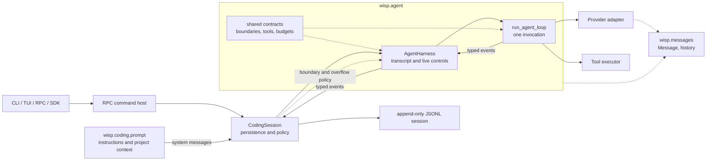

# Agent runtime

`wisp.agent` contains the provider-neutral core of Wisp's agent runtime. It keeps an in-memory
conversation across requests and runs the model/tool cycle. The CLI, TUI, RPC, and SDK all reach
this code through the same `CodingSession` path. The model's instructions are built by the coding
layer, in [`wisp.coding.prompt`](../coding/prompt/).

The package root intentionally re-exports nothing. Import the public `harness` and `loop` APIs from
their package roots, and shared contracts from the module that defines them. The `Message` and
compaction records it exchanges with providers live one layer below, in
[`wisp.messages`](../messages/).

## Big picture



Each layer adds one concern:

| Layer | Lifetime | Owns |
| --- | --- | --- |
| `CodingSession` | Durable conversation | Persistence, compaction orchestration, project context, trust, safety, and cost accounting |
| `AgentHarness` | Across calls in one process | In-memory transcript, steering and follow-up queues, cancellation, and synchronization with session policy |
| `run_agent_loop` | One invocation | Provider turns, context estimates, tool batches, and transient continuation state |
| Provider adapter | One provider protocol | Native request, streaming, replay, continuation, and usage semantics |

This distinction is important because a **conversation**, an **invocation**, and a **turn** are not
the same thing:

- A conversation may contain many user prompts and survive process restarts through a session.
- An invocation is one `prompt()`, `prompt_message()`, or `continue_()` stream on `AgentHarness`.
- A turn is one provider response plus its requested tool batch, if any. `TurnCompleted` ends a turn,
  not necessarily the invocation.

## How one invocation runs

```mermaid
sequenceDiagram
  participant Session as CodingSession
  participant Prompt as prompt builder
  participant Harness as AgentHarness
  participant Loop as run_agent_loop
  participant Provider as Provider adapter
  participant Tools as Tool executor

  Session->>Prompt: Build ordered system messages
  Prompt-->>Session: Instructions and bounded project context
  Session->>Harness: Configure with system messages and restored history
  Session->>Harness: Start prompt or continuation
  Harness->>Harness: Accept the user message
  Harness->>Loop: Start with detached provider history

  Loop->>Provider: Stream one response
  Provider-->>Loop: Deltas, tool calls, usage, terminal outcome
  Loop-->>Harness: Message lifecycle events
  Harness->>Harness: Retain completed assistant message

  opt Response requests tools
    Loop->>Tools: Execute tool batch
    Tools-->>Loop: Approval, execution, and result events
    Loop-->>Harness: Tool lifecycle events
    Harness->>Harness: Retain terminal tool output
  end

  Loop-->>Harness: TurnCompleted
  Harness->>Harness: Drain eligible steering or follow-up messages
  Loop->>Harness: Ask before the next provider request
  Harness->>Session: Ask session policy when configured
  Session-->>Harness: Stop, continue, replace, or rebase
  Harness-->>Loop: Boundary decision

  opt Another turn starts
    Loop-->>Harness: TurnStarted
    Harness->>Harness: Apply accepted transcript transition
  end

  Harness-->>Session: Continue the typed event stream
  Session->>Session: Persist durable events and update accounting
```

Completed assistant messages and terminal tool outputs are added to the harness transcript before
their events are exposed to a caller. This keeps resumable state intact even if the caller closes the
stream immediately after observing an event.

The loop does not mutate its input `messages`. It keeps only the continuation data needed within the
current invocation: the provider cursor, pending tool results, injected user messages, and the
assistant/tool tail produced so far.

### History and continuation terms

- **Portable history** (the *base*): provider-neutral `Message` rows that any adapter can send
  as a fresh request.
- **Provider cursor**: the `previous_response_id` from the last response. Each adapter decides what
  it points to: server-side state for stateful APIs, or a local replay key for stateless ones.
- **Native continuation**: continuing from the cursor instead of resending everything. Appending
  user messages to it needs an adapter that declares `supports_continuation_messages`.
- **Continuation tail**: the assistant and tool rows, plus any injected user messages, produced
  since the current base. The base followed by the tail is the logical transcript. What goes on the
  wire is the adapter's choice: with a cursor, a stateful adapter such as OpenAI sends only the new
  tool outputs and messages, while a stateless one such as Anthropic rebuilds the replay locally.
- **Folding**: with no usable cursor, the loop moves a text-only tail into the base and sends a
  fresh request. A tail containing tool calls is never flattened. Right after a tool batch, the next
  request can still carry the pending tool results; adding extra messages there, or continuing at
  any later boundary, is rejected.
  `_apply_continuation` in [`loop/continuation.py`](./loop/continuation.py) tabulates every case.

## Request boundaries and live input

After a completed turn, the loop consults the request-boundary hook before sampling the provider
again. A decision can:

| Decision field | Effect |
| --- | --- |
| `stop` | End the invocation; this takes precedence over every other field. |
| `extra_messages` | Inject plain user messages into the continued request. Context-overflow recovery cannot add them. |
| `messages` | Replace the portable history and clear native continuation. Cannot be combined with `context_rebase`. |
| `context_rebase` | Replace the portable base while keeping the native continuation tail. Requires an adapter that declares `supports_context_rebase`, a provider cursor, and `expected_continuation_messages` that exactly match the loop's current tail. |

The harness uses this boundary for live input:

- **Steering** is eligible after every successfully completed turn and has priority.
- **Follow-up** is eligible only when a tool-free turn would otherwise stop.
- Both queues are FIFO. `steering_mode` and `follow_up_mode` on `AgentHarnessConfig` choose whether
  a drain injects one message (`"one_at_a_time"`, the default) or the whole current queue (`"all"`).

`CodingSession` also uses the same handshake for compaction and context-overflow recovery. The loop
applies the decision to its next provider request; the harness waits for the matching `TurnStarted`
before applying the transcript transition. That delay keeps provider-visible and harness-visible
history synchronized.

## Package map

| Path | Responsibility |
| --- | --- |
| [`harness/`](./harness/) | Owns the transcript across invocations, live queues, cancellation, and boundary coordination. Start with `runner.AgentHarness._run`. |
| [`loop/`](./loop/) | Implements the provider/tool cycle and emits ordered events for one invocation. Start with `runner.run_agent_loop`. |
| [`request_boundary.py`](./request_boundary.py) | Defines snapshots, replace/rebase decisions, and boundary and overflow hook protocols. |
| [`turn_lifecycle.py`](./turn_lifecycle.py) | Tracks the open turn so each started turn ends exactly once. The loop publishes turns through it; the harness and session use it to build the terminal events they publish themselves. |
| [`tool_contracts.py`](./tool_contracts.py) | Defines ordinary and prepared tool-executor protocols and their lifecycle errors. |
| [`context_budget.py`](./context_budget.py) | Estimates request context, records provider observations, and builds context-pressure budgets. |
| [`transcript_repair.py`](./transcript_repair.py) | Orders tool results and synthesizes missing results after interrupted tool calls. |
| [`validation.py`](./validation.py) | Validates limits shared by harness and loop configuration. |

## Where a change belongs

| Change | Start here |
| --- | --- |
| System instructions or project-file discovery | [`wisp/coding/prompt/`](../coding/prompt/) |
| Transcript retention, queues, or cancellation across calls | [`harness/`](./harness/) |
| Turn sequencing, provider stream validation, or tool scheduling | [`loop/`](./loop/) |
| `Message` records or provider-history normalization | [`wisp/messages/`](../messages/) |
| Provider-specific request or continuation behavior | [`wisp/providers/`](../providers/) |
| Persistence, compaction policy, permissions, or approvals | [`wisp/coding/`](../coding/) |
| Observable event schemas | [`wisp/events/`](../events/) |

Avoid moving policy downward for convenience. In particular, `run_agent_loop` must stay independent
of durable sessions and frontends, while provider-specific behavior must not be flattened into the
shared loop.

## Public imports

```python
from wisp.agent.harness import AgentHarness, AgentHarnessConfig
from wisp.agent.loop import AgentLoopConfig, run_agent_loop

from wisp.agent.request_boundary import RequestBoundaryDecision
from wisp.messages import Message
```

Within these subpackages, import private collaborators from their defining modules rather than from
new compatibility shims.

## Further reading

- [Agent runtime architecture](../../../site/architecture/agent-runtime.md) describes the same
  boundaries in the project documentation.
- [Harness README](./harness/README.md) covers transcript ownership, queues, cancellation, boundary
  synchronization, invariants, and focused tests.
- [Loop README](./loop/README.md) covers turn execution, continuation state, event-order invariants,
  and focused tests.
- [`tests/agent/`](../../../tests/agent/) contains the agent-core regression suites.
